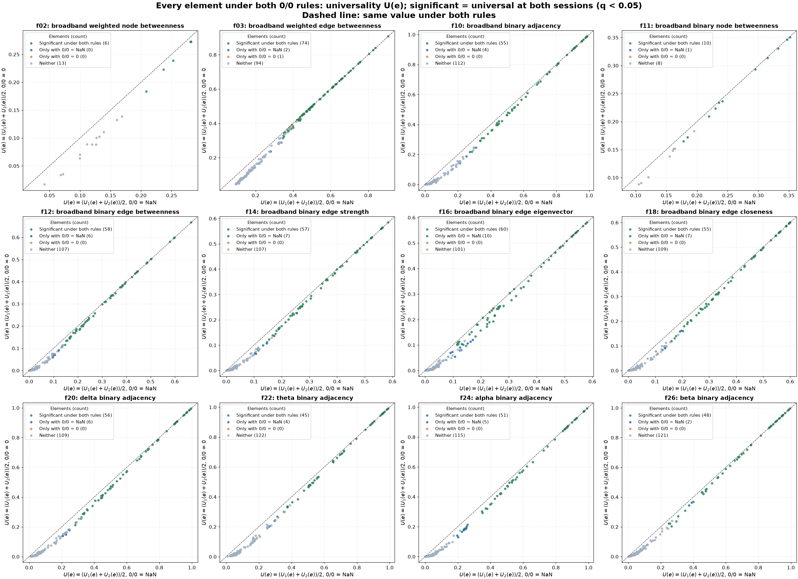
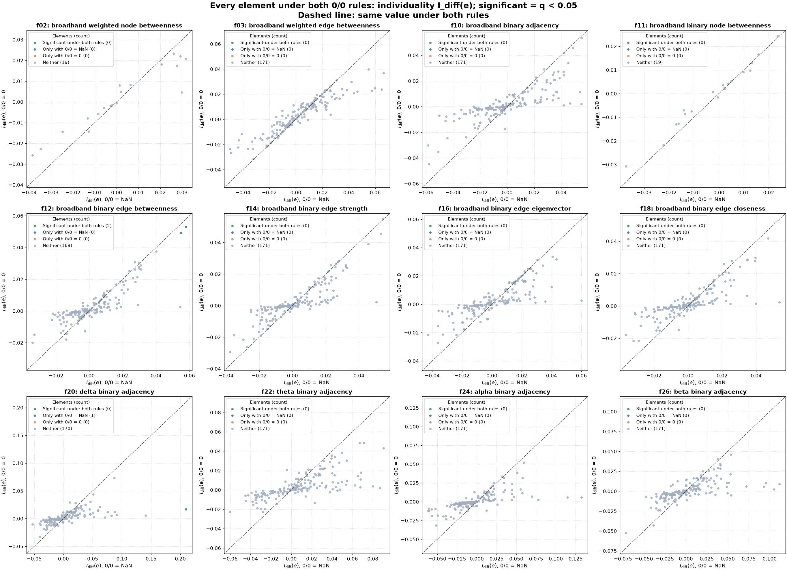
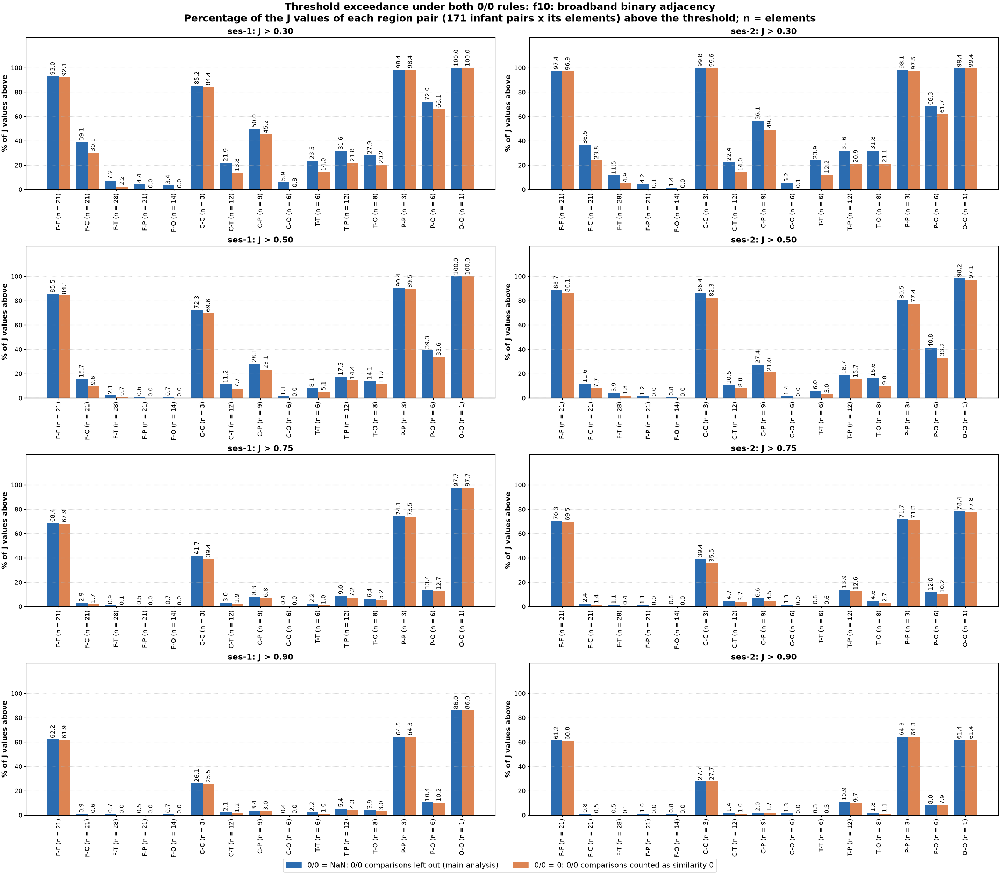

# 0/0 = NaN or 0/0 = 0? What changes in the results

This folder compares the analysis under two rules for one special case of the similarity measure. Everything was recomputed under both rules with the same code, the same random shuffles and the same bootstrap resamples, so every difference here comes from the rule alone.

## In one minute

- **The rule only matters when both values being compared are 0.** That happens in 12 of the 26 feature sets: the binary (on/off) network features and the betweenness measures. The other 14 feature sets give identical results under both rules.
- **The headline results do not change.** Universality U, within-session stability W − O, individuality I_diff and identification accuracy are identical for 25 feature sets. In f02 they change by less than 0.0001.
- **Results for single nodes and links do change**, for those 12 feature sets:
  - Similarities are never higher under 0/0 = 0, so fewer nodes and links count as universal (629 → 576).
  - Fewer count as stable within a session.
  - About twice as many show a change between 3 and 6 months (41 → 82).
  - One link that looked personal under 0/0 = NaN (f20, F8–T6) is no longer significant.
- **The threshold bars are lower or equal under 0/0 = 0**, by up to 14.5 percentage points, mostly at the 0.30 threshold.
- **The trade-off:**
  - 0/0 = NaN can make very rare links look perfectly similar or perfectly stable, based on one or two epochs.
  - 0/0 = 0 ties similarity to how often a link is present, so rare links always look dissimilar.

## 1. What "0/0" means

The similarity of two values is the smaller one divided by the larger one:

| Values compared | Similarity |
| :--- | :--- |
| 0.4 and 0.8 | 0.4 / 0.8 = 0.5 |
| 1 and 1 (both babies have the link) | 1 / 1 = 1 |
| 1 and 0 (only one baby has it) | 0 / 1 = 0 |
| 0 and 0 (neither baby has it) | 0 / 0, which has no answer |

There are two ways to handle the last case:

- **0/0 = NaN** (the main analysis): skip that comparison and average the rest.
- **0/0 = 0** (the old notebooks, and robustness check 1): count it as "not similar at all".

**Example.** Two babies are compared on one link over their 12 epochs:

- Baby A has the link in epochs 1, 2 and 3.
- Baby B has it in epochs 1 and 2.
- Neither has it in epochs 4 to 12.

Epoch by epoch the similarities are 1, 1, 0, and then nine 0/0.

| Rule | Calculation | Similarity |
| :--- | :--- | :--- |
| 0/0 = NaN | (1 + 1 + 0) / 3 | 0.67 |
| 0/0 = 0 | (1 + 1 + 0 + 0 + … + 0) / 12 | 0.17 |

In words:

- **0/0 = NaN asks:** "When at least one of the two babies has the link, how often do both have it?"
- **0/0 = 0 asks:** "In how many of the 12 epochs do both babies have the link?"

So 0/0 = 0 treats "both babies lack the link" as complete disagreement. A link that is usually absent can never look similar, even though the babies agree that it is absent. 0/0 = NaN ignores those epochs, so a rare link can look perfectly similar on the strength of a single epoch. Neither rule counts "both lack it" as agreement; a third rule, 0/0 = 1, would, but it was not computed here.

## 2. Which results can change

Only comparisons where both values are exactly 0 are affected, so only feature sets that contain zeros can change. There are 12:

- **Betweenness:** f02 (weighted node betweenness), f03 (weighted edge betweenness) and f11 (binary node betweenness).
- **Broadband binary link features:** f10 (adjacency), f12 (edge betweenness), f14 (edge strength), f16 (edge eigenvector) and f18 (edge closeness).
- **Band binary adjacency:** f20 (delta), f22 (theta), f24 (alpha) and f26 (beta).

The other 14 feature sets have no zero values at all: f01, f04, f05, f06, f07, f08, f09, f13, f15, f17, f19, f21, f23 and f25. Their results are identical under both rules, which the script checks.

How often a single-epoch comparison is 0/0 (both babies 0):

| Feature sets | Share of 0/0 comparisons |
| :--- | :--- |
| The nine binary link features (f10–f26) | 49–60% |
| f02, weighted node betweenness | 25–28% |
| f03, weighted edge betweenness | 16–20% |
| f11, binary node betweenness | 7–8% |

The whole-recording similarity S first adds up all nodes or links of an epoch, and only then divides. So it is 0/0 only when a baby's whole epoch is zero. That happened in just 2 epoch pairs in the whole dataset, both in f02 when comparing ses-1 with ses-2.

## 3. Headline results: no meaningful change

Universality U, its change ΔU, within-session stability W − O, I_self, I_others, I_diff and identification accuracy are identical under both rules for 25 of the 26 feature sets. The p-values are identical too.

The only change is in f02, caused by those 2 all-zero epoch pairs:

| f02, weighted node betweenness | 0/0 = NaN | 0/0 = 0 |
| :--- | :--- | :--- |
| I_others | 0.192442 | 0.192415 |
| I_diff | 0.008325 | 0.008352 |
| p of I_diff | 0.0757 | 0.0751 |
| Identification accuracy | 7.9% | 7.9% |

## 4. Results for single nodes and links: this is where the rule matters

Counts over the 12 feature sets that contain zeros, 1,748 nodes and links in total. "Significant" means q < 0.05 after FDR correction, as in the main analysis.

| Result | 0/0 = NaN | 0/0 = 0 |
| :--- | :---: | :---: |
| Universal at ses-1, U_1(e) significant | 693 | 643 |
| Universal at ses-2, U_2(e) significant | 715 | 639 |
| Universal at both sessions | 629 | 576 |
| Significant change 3 → 6 months, ΔU(e) up | 18 | 33 |
| Significant change 3 → 6 months, ΔU(e) down | 23 | 49 |
| Stable within a session, W_1(e) − O_1(e) significant | 56 | 42 |
| Stable within a session, W_2(e) − O_2(e) significant | 25 | 7 |
| Personal across sessions, I_diff(e) significant | 3 | 2 |

`results/element_summary.csv` gives these counts per feature set.

**Universality is lower or equal under 0/0 = 0, for every node and link.** No value is ever higher, because counting "both lack it" as 0 can only pull an average down. 54 links that are universal under 0/0 = NaN are not universal under 0/0 = 0, and 1 link gains (f03, F3–C4).



**0/0 = 0 finds about twice as many changes between 3 and 6 months (82 against 41).** Most of the extra findings are links whose presence changed a lot between the visits. On average their presence went up or down by 15.6 percentage points, compared with 5.4 points for links with no significant change under either rule. Under 0/0 = 0, a link that becomes rarer automatically looks like babies becoming less alike, even if babies who have the link agree just as much as before. Under 0/0 = NaN it does not.

**0/0 = NaN finds more within-session stability, partly from very rare links.** No link is stable only under 0/0 = 0. Several links that are stable only under 0/0 = NaN are so rare that their value rests on one baby:

- **f10, Fp1–O2 at ses-2:**
  - The link is present in only 2 of the 228 baby-epochs (0.9%).
  - Its similarity is undefined for 153 of the 171 baby pairs.
  - Under 0/0 = NaN, W_2(e) − O_2(e) = 1.000, the largest possible value, with q = 0.0009.
  - Under 0/0 = 0 it is 0.009, with q = 0.96.
- **The same link in other feature sets:** it is also "stable" in f12, f14, f16 and f18.
- **f26, FZ–P3:** goes from 1.000 to 0.009.

**Personal links across sessions.** Two links are significant under both rules: f12, Fp2–F7 (q = 0.033 and 0.034) and f12, C4–P4 (q = 0.033 and 0.019). One link is significant only under 0/0 = NaN:

- **f20, F8–T6:**
  - I_diff(e) = 0.210 under 0/0 = NaN (q = 0.017).
  - I_diff(e) = 0.017 under 0/0 = 0 (q = 0.73).
  - Its similarity is undefined for 28 baby pairs at ses-1 and 45 at ses-2, so the 0/0 = NaN value rests on the remaining comparisons.



**Taxonomy classes.** 56 of the 1,748 nodes and links change class:

- 54 go from universal to neither.
- f20, F8–T6 goes from individual to neither.
- f03, F3–C4 goes from neither to universal.

## 5. Regional universality U_s(g)

The average similarity of each region or region pair is lower or equal under 0/0 = 0 in all 320 feature × session × region combinations. 13 are unchanged. The biggest drops are in temporal links of the band binary networks; for example, f26 (beta) at ses-2, T-T falls from 0.3070 to 0.1696. See `results/regional_comparison.csv`.

## 6. The threshold bars

Under 0/0 = 0, two things change at once:
1. **The count includes more values.** The percentage is out of all values, not only the defined ones.
2. **The values themselves are lower.** Epochs where neither baby has the link now count as 0.

The second effect matters even where no value is undefined. In f20 (delta) at ses-2, F-C, all 3,591 values are defined, yet the share above 0.30 falls from 38.0% to 25.0%.

Percentages are never higher under 0/0 = 0. The drop shrinks as the threshold rises:

| Threshold | Average drop (percentage points) | Largest drop |
| :---: | :---: | :---: |
| J > 0.30 | 4.2 | 14.5 |
| J > 0.50 | 1.7 | 10.8 |
| J > 0.75 | 0.6 | 7.6 |
| J > 0.90 | 0.3 | 3.6 |

Averages are over the 320 feature × session × region combinations.

The largest drop is f24 (alpha) at ses-2, T-T: 38.2% → 23.8% above 0.30. Region pairs where links are common barely move; for example, in f10 at ses-1, F-F goes from 93.0% to 92.1% above 0.30. Region pairs where links are rare move most; in the same feature, F-C goes from 39.1% to 30.1%.



All 12 feature sets are in `figures/threshold_bars_nan_vs_zero.pdf`, one page each.

## 7. What this means for choosing a rule

- **Headline conclusions do not depend on the choice:** universality, within-session stability, the weak individuality across sessions, and identification accuracy.
- **For binary networks and betweenness, single-node and single-link results do depend on it.** So do the threshold bars.
- **0/0 = NaN:**
  - It measures agreement only where at least one baby has the link, independent of how common the link is.
  - For rare links, a value can rest on one or two epochs and be extreme (0 or 1). A few significant results then come from one or two babies, like f10, Fp1–O2 above.
- **0/0 = 0:**
  - It uses all 12 epochs for every pair, so values are steadier.
  - It mixes "how alike" with "how common". Rare links always look dissimilar, and a link that becomes rarer looks like babies becoming less alike.
- **Other options, not computed here:**
  - 0/0 = 1 would count "both babies lack the link" as agreement.
  - The NaN rule could be kept, but only for nodes and links with enough defined comparisons.

## Files in this folder

| File | What it contains |
| :--- | :--- |
| `compare_zero_rules.py` | Computes everything below under both rules |
| `check_comparison.py` | Independent check: recomputes every value in the tables from the raw feature tensors |
| `check_readme_numbers.py` | Checks every number in this README against the tables |
| `results/zero_counts.csv` | How often 0/0 happens in each feature set, at each level |
| `results/global_comparison.csv` | Headline results of all 26 feature sets under both rules, with differences |
| `results/element_comparison.csv` | Every node and link of the 12 feature sets with zeros: values, p, q and class under both rules |
| `results/element_summary.csv` | Counts of significant nodes and links, and of classes, per feature set and rule |
| `results/regional_comparison.csv` | U_s(g) with 95% CI per region or region pair, under both rules |
| `results/threshold_comparison.csv` | Percentage above 0.30, 0.50, 0.75 and 0.90 per region or region pair, under both rules |
| `results/validation_vs_pipeline.csv` | 0/0 = NaN results here against the saved pipeline results |
| `results/check_report.txt` | Output of `check_comparison.py` |
| `results/run_info.json`, `results/run.log` | Settings and log of the run |
| `figures/threshold_bars_nan_vs_zero.pdf` | Threshold bars under both rules, one page per feature set (f10 also as PNG) |
| `figures/element_values_nan_vs_zero.pdf` | Every node and link under both rules: universality (page 1) and individuality (page 2), also as PNGs |

## How this was computed and checked

**Same code, same randomness.**
- The comparison uses the pipeline's own functions for both rules: the 0/0 switch of Phase 7 check 1, and the steps of Phases 2 to 5.
- Both rules use 200,000 permutations and bootstrap resamples, seed 42, and the same shuffles and resamples.
- The universality test for single nodes and links uses Phase 7's faster version of the Phase 2 shuffle test. Its p-values agree with Phase 2 up to random variation.

**Checked against the main analysis.**
- With 0/0 = NaN, every value matches the saved pipeline results exactly: all 1,104,660 pair-by-element similarities, plus U, U(e), ΔU(e), W − O, W(e) − O(e), I_diff, I_diff(e) and accuracy. The bootstrap p-values match too.
- All 3,496 significance decisions for U_1(e) and U_2(e) are the same as in the pipeline.
- The only differences are 381 p-values of I_diff(e), and one accuracy p-value of f19 (which has no zeros). They come from the tie fix of 3 November, which the saved results predate. So the 0/0 = NaN numbers here are the up-to-date ones: for example, the main tables still list 10 significant I_diff(e) links, but the current code finds 3.

**Checked independently.** `check_comparison.py` recomputes every value in the tables from the raw feature tensors with its own short code (55,796 values), then rebuilds the q-values, classes and counts. It found 0 problems, and it does catch errors planted on purpose. `check_readme_numbers.py` rebuilds every result sentence of this README from the tables and confirms that no other number appears without a check.

**To rerun**, from the project root (about 30 minutes):

```bash
.venv/bin/python zero_rule_comparison/compare_zero_rules.py --workers 12
.venv/bin/python zero_rule_comparison/check_comparison.py
.venv/bin/python zero_rule_comparison/check_readme_numbers.py
```
